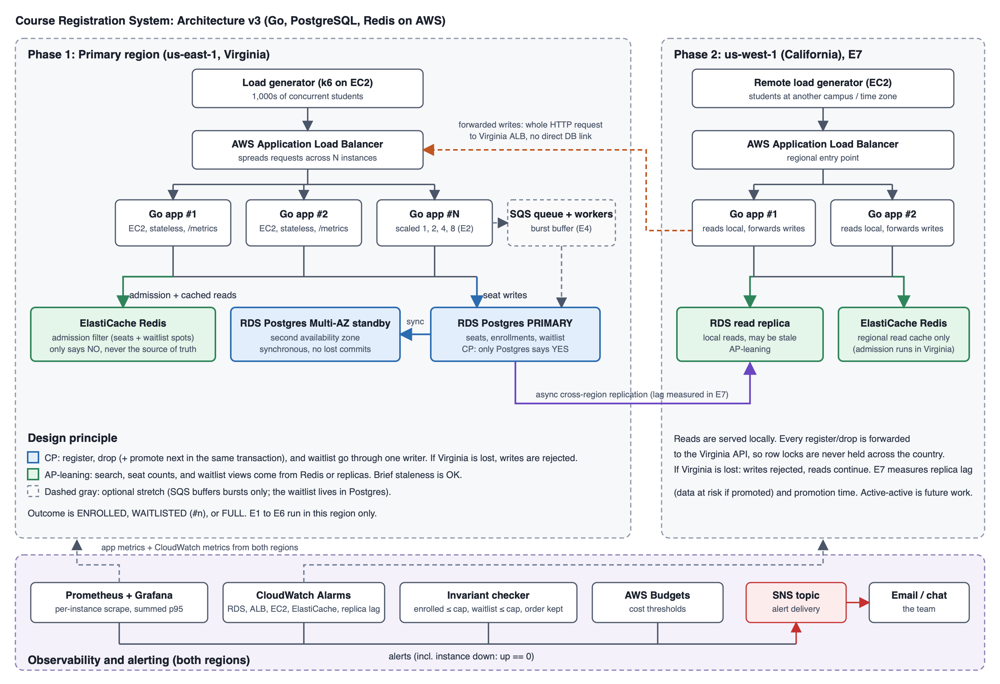

# Architecture: Course Registration System

Stack: **Go** (app), **PostgreSQL** (source of truth), **Redis** (admission filter and cache), on **AWS**. Local development uses Docker Compose.

Editable source: `architecture.svg`.

## Design principle

| Operation | Choice | Mechanism |
|---|---|---|
| Register / drop a seat, join or leave the waitlist | **CP** | One writer (RDS Postgres primary) with a synchronous Multi-AZ standby. Outcome is ENROLLED, WAITLISTED (#n), or FULL. During a partition or primary-region outage, writes are rejected. |
| Seat-count and course-search reads | **AP-leaning** | Redis cache and read replicas. Brief staleness is accepted and measured (E6, E7). |
| Waitlist view | **AP-leaning** | Replica or cache read. The primary decides ordering. |

Redis may only say **no**; only Postgres can say **yes**. Redis rejects requests early once seats and waitlist spots are full, which protects the database during a spike. A wrong "no" costs a student a retry; a wrong "yes" would break zero over-enrollment, so every request Redis lets through is still decided by Postgres. A background job resyncs the Redis counter from Postgres every few seconds, drops increment it immediately, and an empty Redis (after a restart) lets requests through to Postgres.

## Phasing

- **Phase 1:** a complete single-region system (us-east-1, Virginia) and experiments E1–E6.
- **Phase 2:** second region (us-west-1, California) and E7, built only after Phase 1 is done.

## Components

### Phase 1: Primary region (us-east-1, Virginia)

| Component | Purpose |
|---|---|
| Load generator (k6 on EC2) | Simulates thousands of concurrent students. Runs in the same region so E1–E6 are not distorted by cross-region latency. |
| Application Load Balancer | Spreads requests across N app instances. |
| Go app instances (EC2, stateless) | Register, drop, waitlist, and seat-count APIs. Expose `/metrics`. Scaled to 1, 2, 4, 8 instances in E2. |
| ElastiCache Redis | Admission filter (tracks seats + waitlist spots, can only say no) and read cache. |
| RDS Postgres primary | Single writer (CP). Holds `sections(capacity, waitlist_cap, enrolled)`, `enrollments`, and `waitlist`. Drop and promote-next happen in one transaction. Registration is a single SQL statement so the row lock lasts about 1 ms. |
| RDS Multi-AZ standby | Synchronous replica in a second availability zone. Takes over on failure without losing committed writes (tested in E5). |
| SQS queue + workers *(stretch)* | Optional burst buffer for E4 only. It is not the waitlist (the waitlist lives in Postgres). Workers must be idempotent because standard SQS is at-least-once. |

### Phase 2: Second region (us-west-1, California), E7 only

| Component | Purpose |
|---|---|
| Remote load generator | Simulates students at another campus or time zone. |
| ALB + Go app instances | Regional entry point. Reads are served locally. Every register/drop is forwarded as a whole HTTP request to the Virginia ALB. The remote app never connects to the primary database, so row locks are never held across the country. |
| RDS read replica (async) | Local reads that may be stale. Replica lag is measured. RDS cross-region replicas are asynchronous, so we do not auto-promote; E7 measures what failover would cost (data at risk and promotion time). |
| Regional Redis | Regional read cache. |

### Observability and alerting (both regions)

| Component | Purpose |
|---|---|
| Prometheus + Grafana | One Prometheus per region. It scrapes each app instance directly using EC2 service discovery (not through the ALB), so counters are not mixed across instances. p95 is computed from summed histogram buckets. One dashboard per experiment. |
| CloudWatch Alarms | RDS, ALB, EC2, and ElastiCache metrics. |
| Invariant checker | Checks `enrolled <= capacity`, `waitlist <= waitlist_cap`, that no student is both enrolled and waitlisted, and that promotion follows join order. Raises a critical alert. |
| AWS Budgets | Cost thresholds for our own AWS spend. |
| SNS topic | Delivers all alerts by email or a chat webhook. |

## Request flows

1. **Register (primary region):** client → ALB → Go app → Redis admission check (may say no) → one Postgres statement: claim a seat, or join the waitlist, or report full → response (ENROLLED, WAITLISTED #n, or FULL).
2. **Read seat counts:** client → ALB → Go app → Redis cache → fall back to Postgres or a replica on a miss.
3. **Register (second region):** client → regional ALB → Go app → whole HTTP request forwarded to the Virginia ALB → handled in Virginia → response. Reads stay local.
3b. **Drop:** Go app → one transaction: remove the enrollment and promote the first waitlisted student.
4. **Queued register (stretch):** client → Go app → SQS → worker → Postgres. The client polls for the result. Used only to buffer bursts.

## Alerts

| Alert | Source | Severity |
|---|---|---|
| Over-enrollment, over-full waitlist, or student both enrolled and waitlisted | Invariant checker | Critical |
| App instance down (`up == 0`) | Prometheus / Grafana | High |
| p95 latency above target for 5 minutes | Grafana / ALB | High |
| 5xx or registration error rate above 1% | ALB / Grafana | High |
| RDS replica lag above threshold | CloudWatch | Medium |
| RDS CPU or connections near limit | CloudWatch | Medium |
| Redis memory or evictions high | CloudWatch | Medium |
| AWS spend passes budget thresholds | AWS Budgets | Medium |

## Experiments mapped to the architecture

| # | Experiment | Parts exercised |
|---|---|---|
| E1 | Correctness under contention (+ drop storm) | App + Postgres (naive vs. locking vs. atomic update vs. Redis admission); waitlist promotion order |
| E2 | Horizontal scaling | ALB + 1, 2, 4, 8 app instances |
| E3 | Strategy performance | Postgres locking vs. atomic update vs. Redis admission |
| E4 | Traffic spike | Load generator, Redis, optional SQS |
| E5 | Failure injection | Kill an app instance, kill Redis, force RDS Multi-AZ failover |
| E6 | Read caching | Redis cache vs. direct reads (staleness) |
| E7 (Phase 2) | Multi-region | Second region; direct DB writes vs. forwarded writes; replica lag during a spike; promotion time; primary-region outage |

## Open decisions for the team

- Instance sizes (regions are us-east-1 and us-west-1; confirm both are available in the AWS Learner Lab)
- Terraform or CloudFormation for infrastructure-as-code
- Whether the minimal waitlist stays in the core (it adds a table, a promotion transaction, and invariant checks), or moves back to future work
- Whether the SQS variant and E7 stay in scope, or become future work if time runs short
