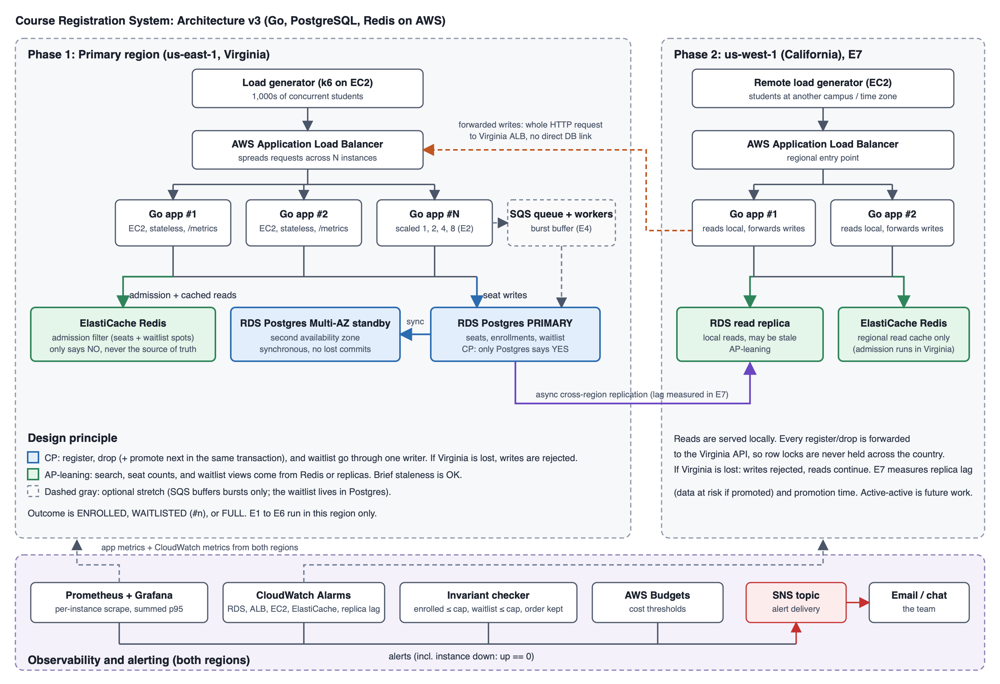

> **DRAFT NOTE (delete before submitting):** Items marked **[FILL IN]** are facts only the team knows (backgrounds, real measurements, meeting times). Nothing in Section 6 has been measured yet. Do not submit invented numbers.

# 1. Problem, Team, and Overview of Experiments

**Problem.** When course registration opens, thousands of students hit the system within seconds, all competing for a small number of seats. Under this load, naive systems show three failures: slow or failed requests, **race conditions that over-enroll a section** (two students both read "1 seat left" and both succeed), and stale seat counts that mislead students. Students lose seats they should have had. Administrators have to manually fix over-enrolled sections and field complaints. Our stakeholders are **students** (fair, fast, correct enrollment), **registrar/administrators** (seat limits are never violated, and they can see system health), and **future developers/operators** (they need to know where the system's limits are before registration day).

**Team.**

| Member | What they bring |
|---|---|
| Suyash Muley | Builds and owns the Go service and its correctness: the PostgreSQL schema (including the waitlist), the HTTP API, the seat-allocation strategies (naive, atomic, locking, and the Redis admission filter), and the concurrency tests. Previously built a Go key-value store backed by DynamoDB in an earlier course assignment, which this project builds on. |
| Santosh Sunkara | Infrastructure as code with Terraform and Ansible from prior industry work; containers with Docker and Kubernetes; hands-on with core AWS services. Leads AWS deployment and load testing. |
| Sameep Sawant | **[FILL IN: e.g., observability, data analysis, Redis/caching]** |

**Results our experiments will evaluate.** (1) *Correctness*: zero over-enrollment and zero lost or duplicated enrollments under contention. (2) *Performance*: throughput (registrations/s), median and p95/p99 latency, error rate. (3) *Scalability*: how throughput changes as we add application instances, and where the database becomes the bottleneck. (4) *Resilience*: behavior during traffic spikes and when an application server or Redis is killed. (5) *Multi-region behavior*: many universities have campuses in different locations and time zones, so we evaluate the latency and consistency cost (cross-region write latency, row-lock hold time, stale cached reads) when users connect from a remote region, and what happens to them when the primary region fails. (6) *Waitlist correctness*: waitlist order is preserved and a freed seat always goes to the first waitlisted student, even during a burst of drops.

**Role of AI.** AI is a development assistant (code generation, test scaffolding, log/metric analysis, and documentation drafts). The *system itself* has no AI component in its request path. This keeps behavior deterministic and cost predictable. See Sections 2 and 3.

**Observability plan.** Every Go instance exports metrics (request count, latency histograms, error counts, seat-conflict/retry counts, DB connection-pool usage) to Prometheus (which scrapes each instance directly through EC2 service discovery, not through the load balancer) and displays them in Grafana. AWS CloudWatch supplies infrastructure metrics for RDS (CPU, connections, IOPS), ElastiCache, the load balancer, and EC2. Logs are structured JSON with a request ID that follows each request through the load balancer, app, and database. Alerting is built in: CloudWatch Alarms and Grafana alerts on latency, error rate, and an over-enrollment invariant check, delivered through Amazon SNS. Load-test results are stored as CSV so every graph in the final report can be regenerated.

# 2. Project Plan and Recent Progress

**Recent progress.** As of November 22, we have completed:

- **Design:** chose the stack (Go, PostgreSQL, Redis, AWS) and the architecture, with CP seat writes and AP-leaning reads. A teammate reviewed the first design and raised seven concerns (Redis as an admission filter only, a Postgres waitlist, forwarding remote writes instead of holding row locks across regions, failover behavior, Prometheus scraping, region choice, and scope). We adopted them and split the work into Phase 1 (single region, E1–E6) and Phase 2 (second region, E7).
- **Repository:** a GitHub repo with an ownership-based layout and `CODEOWNERS`, so each member works in separate directories and pull requests need the owner's approval. An AWS account is available to the team.
- **Data model:** a PostgreSQL schema for sections, students, enrollments, and a capped waitlist.
- **Service:** a Go HTTP service with register, drop, and seat-count endpoints, a configurable seat strategy, and unit tests for the handlers.
- **Strategies and first results:** the naive baseline and the atomic single-statement strategy, tested against a real PostgreSQL. In an early check with 200 concurrent registrations for 10 seats, naive enrolled 200 and atomic enrolled exactly 10. E1 was then run through the HTTP service with k6 (3 runs per strategy, 1,000 students for 10 seats): atomic enrolled exactly 10 every time, and naive over-enrolled in every run (Section 6).
- **AWS Learner Lab check:** verified the AWS Learner Lab limits by test-launching RDS: PostgreSQL with Multi-AZ works, but read replicas are blocked and only us-east-1 and us-west-2 are available.
- **Local stack and load test:** a Docker Compose setup (Go service and PostgreSQL with seed data) and a k6 script for E1 that sends 1,000 simultaneous registrations through the HTTP service for a 10-seat section, with the committed results of 3 runs per strategy (Section 6).

**[Sameep: add anything you have completed, e.g., dashboards.]** Our earlier coursework (the key-value/DynamoDB store from the homework) gives us a base for storing and updating seat counts.

**Timeline and task breakdown** (about 3 weeks of remaining work; adjust to the real deadline):

| Week | Milestone | Owner(s) |
|---|---|---|
| Nov 23–29 | Waitlist (join, leave, promote on drop); locking strategy; real metrics endpoint and first Prometheus/Grafana dashboard; AWS budget alarm and first RDS/ElastiCache launch. *Already done (Nov 22): single-instance Go service, schema, Docker Compose, and E1.* | Suyash (waitlist, locking), Sameep (metrics), Santosh (AWS setup) |
| Nov 30–Dec 6 | Deploy to AWS (EC2 instances behind an ALB, RDS Postgres, ElastiCache Redis); concurrency-control variants; Prometheus + Grafana; load-test harness | Santosh (AWS/LB/harness), Suyash (concurrency), Sameep (dashboards) |
| Dec 7–13 | Run E1–E6 (Phase 1, single region); Redis variants; failure injection; analysis. **Phase 2, only if E1–E6 are done:** second region in us-west-2 (app instances, regional Redis cache, and remote clients, E7) | All; Santosh runs tests and the second region, Sameep analyzes |
| Dec 14–end | Final report, graphs, demo, cleanup, README for classmates | All |

**Who does what.** Suyash owns the application service and correctness (concurrency control, tests). Santosh owns infrastructure and load generation (load balancer, deployment, workload scripts, failure injection). Sameep owns observability and analysis (metrics, dashboards, plots, cache layer). Each person reviews at least one other person's pull request every week.

**AI in the plan: costs and benefits.**

*Benefits:* faster boilerplate (handlers, Docker/Prometheus configs, load-test scripts); help writing concurrency tests and edge cases we might miss; quicker log and result analysis; draft documentation.

*Costs/risks:* generated concurrency code can look right but contain subtle races, so it needs careful review and the over-enrollment test. Wrong or hallucinated configs can waste debugging time. There is time spent writing prompts and verifying output. Tool subscription or API costs are minimal **[FILL IN]**. Mitigation: no AI-generated code is merged without a human reviewer and passing tests, and we note which parts were AI-assisted in the report.

# 3. Objectives

**Short-term (this course).**

1. Build a working multi-instance registration service with a shared database and a load balancer.
2. Demonstrate and then eliminate over-enrollment using concurrency control.
3. Measure throughput and p95 latency as instances scale from 1 to N, and identify the bottleneck.
4. Compare at least two seat-allocation strategies and a caching/queueing option with Redis.
5. Provide dashboards and structured logs that make failures diagnosable.
6. Support a capped waitlist (enrolled, waitlisted at position n, or full), with the first waitlisted student promoted in the same transaction as a drop.
7. **Phase 2:** once the single-region system and E1–E6 are done, evaluate a second region (us-west-2, a West Coast campus) to measure the latency and consistency cost of serving campuses in different time zones.

**Design principle: CP for writes, AP-leaning for reads.** We choose consistency per operation, not one setting for the whole system. *Registering or dropping a seat is CP*: a single writer (PostgreSQL, Multi-AZ with synchronous replication) guarantees zero over-enrollment, and during a partition or a primary-region outage the system rejects writes instead of risking an oversold section. We stay highly available against likely failures (an app instance, a Redis node, or an availability zone) because the synchronous standby takes over without losing committed writes. The second region holds no copy of the database. A cross-region replica would be asynchronous, so promoting it after a region loss could drop the most recent enrollments or double-assign a seat, and the AWS Learner Lab does not allow RDS read replicas in any case. If the primary region is lost, writes are rejected until it returns. Redis may only say *no* (reject early once a section and its waitlist are full); only Postgres can say *yes*. *Course search, seat-count display, and waitlist views are AP-leaning*: they are served from the Redis cache, so they stay fast and available during failures at the cost of brief staleness. We do not claim to have both properties during a partition: for seat writes we explicitly choose consistency.

**Long-term vision.** A reference architecture and benchmark kit that a university could use to size and stress-test its registration system *before* registration day. Concrete future work: (a) partition/shard seat counts by course to remove the single-row hot spot; (b) priority registration windows (seniors first) and student notifications (seat granted, waitlist movement) sent through Amazon SNS, building on the core waitlist; (c) cross-region read replicas with measured replica lag and failover cost, and then a full active-active multi-region deployment with regional write capability and explicit consistency tradeoffs, plus per-campus registration windows in local time zones; (d) autoscaling driven by the same metrics we collect; (e) SLO tracking and burn-rate alerting built on the alerts we define now (for example, "p95 < 500 ms, zero over-enrollment"); (f) replaying anonymized real registration traces.

**Observability, reliability, and cost control for deployers.** Observability is a core objective: dashboards for the four golden signals (latency, traffic, errors, saturation), an invariant checker that continuously verifies `enrolled <= capacity` for every section, and runbook-style notes on what each alert means. The system has no AI in production, so there is no model-cost or nondeterminism risk for deployers. Where AI helped build it, correctness is guaranteed by the test suite and invariant checker, not by trust in the tool. Infrastructure cost is controlled by documenting the capacity measured per instance, so operators can choose the smallest fleet that meets the target. For our own AWS usage we set an AWS Budgets alarm, use small instance types, run experiments in short windows, and tear down the environment (via infrastructure-as-code) when not testing. We delete the RDS database rather than only stopping it, because the lab session does not stop it and AWS restarts a stopped instance automatically after seven days.

# 4. Related Work

- **Course readings.** *Dynamo: Amazon's Highly Available Key-value Store* (DeCandia et al.) motivates our consistency vs. availability tradeoffs, and ties to our DynamoDB homework. **[FILL IN: confirm and add other course readings, e.g., on CAP theorem, consensus, consistency models, caching, and observability.]** Brewer's CAP theorem frames our choice. Dynamo is an AP design, which suits our read paths (course search, seat-count display), while seat writes need a CP design, so we use a single consistent writer. Real systems mix both per operation, and some are tunable (e.g., DynamoDB strongly vs. eventually consistent reads), so we pick per operation.
- **Concurrency control.** Classic work on optimistic vs. pessimistic locking and serializable isolation (Bernstein & Goodman; Berenson et al., "A Critique of ANSI SQL Isolation Levels") underlies our row-lock vs. conditional-update comparison.
- **Hot spots and ticketing systems.** Ticket sales, flash sales, and airline booking face the same "many buyers, few items" contention; common solutions include atomic counters, queues, and virtual waiting rooms. We apply these ideas to registration.
- **Geo-distribution.** Google Spanner (Corbett et al.), Amazon Aurora Global Database, and DynamoDB Global Tables show the main options for multi-region data: a single write region with read replicas, or multi-writer replication with conflict resolution or consensus. The PACELC tradeoff (Abadi) frames our question: even without failures, lower latency costs consistency. Seat counts need a single writer, so we test that design and discuss what active-active would require.
- **Caching and Redis.** Redis atomic operations (`DECR`, Lua scripts) are widely used for inventory counters and rate limiting. We evaluate their tradeoffs against database-only designs.
- **Scalability.** Amdahl's law and the Universal Scalability Law (Gunther) explain why adding servers does not scale linearly when a shared resource is serialized, which is our central hypothesis.
- **Observability.** Google SRE's "four golden signals" and the Prometheus/Grafana ecosystem guide our metrics design.
- **Other teams.** **[FILL IN: any classmate projects on load balancing, caching, or observability. Reach out and cite them.]**

Our contribution is a small, reproducible, end-to-end experiment on one concrete domain, which measures where scaling stops and shows what each fix costs.

# 5. Methodology

**Tech stack.** Go (application service), PostgreSQL (source of truth), Redis (admission/caching), Docker, and AWS as the cloud provider.

**Phasing.** *Phase 1* is a complete single-region system (us-east-1) and experiments E1–E6. *Phase 2* adds a second region (us-west-2) and E7, and is built only after Phase 1 is done.

**Architecture.** Clients (load generator running on a separate EC2 instance in the same region) → AWS Application Load Balancer → N stateless Go application instances on EC2 (containerized) → shared **Amazon RDS for PostgreSQL** as the source of truth, with **Amazon ElastiCache for Redis** for caching and admission control. Prometheus and Grafana run on a separate EC2 instance (one Prometheus per region), scraping each app instance directly, and CloudWatch collects managed-service metrics. **Multi-region extension (Phase 2).** Real universities have campuses in several locations and time zones. We deploy a second region (us-west-2, a West Coast campus) containing its own application instances behind an ALB and a regional Redis read cache, but no database, because the AWS Learner Lab does not allow RDS read replicas. Seat-changing requests are **forwarded as whole HTTP requests to the primary region's ALB**; the remote app never opens a database connection to the primary. This way the cross-country round trip happens *before* a row lock is taken, not while one is held, and the seat invariant still has one writer. Registration is a single SQL statement (conditional update plus insert), so the lock lasts about 1 ms in any region. Reads (course search, seat counts, waitlist views) are served from the regional cache, with possibly stale data; cache misses go to the primary region. Remote-region clients are generated from EC2 instances in the second region. Main experiments E1–E6 run in a single region so that cross-region latency does not distort them. The same containers run locally with Docker Compose for development, and the AWS environment is defined as infrastructure-as-code (e.g., Terraform or CloudFormation) so it can be created, scaled to N instances, and torn down reproducibly. Instance types, RDS size, and region are fixed and recorded for every experiment.

**Consistency model per operation.**

| Operation | Choice | Mechanism |
|---|---|---|
| Register / drop a seat, join or leave the waitlist | CP | Single-writer Postgres (RDS Multi-AZ, synchronous standby). Outcome is one of ENROLLED, WAITLISTED (#n), or FULL. Redis can only say *no* early and never says *yes*. |
| Seat-count and course-search reads | AP-leaning | Redis cache (falls back to the primary); bounded staleness measured in E6/E7 |
| Waitlist view (position) | AP-leaning | Cache read; ordering is decided by the primary |

**Data model.** `sections(id, capacity, waitlist_cap, enrolled)`, `students(id)`, `enrollments(student_id, section_id)` with a unique constraint on the pair, and `waitlist(section_id, student_id, position/joined_at)` with a unique constraint on `(section_id, student_id)`. A student is never both enrolled and waitlisted in the same section. When a student drops, the first waitlisted student is promoted **in the same transaction**, so a new registration can never take the freed seat ahead of the person who was waiting. The waitlist lives in Postgres, not SQS, because it needs positions, leaving the list, and promotion inside the drop transaction, none of which a standard queue provides.

**Redis admission filter.** Redis tracks seats plus waitlist spots per section and rejects requests instantly once both are full, which protects the database during a spike. A wrong *no* only costs a student a retry; a wrong *yes* would break the zero over-enrollment guarantee, so every request that Redis lets through is still decided by Postgres. A background job resyncs the Redis counter from Postgres every few seconds, drops increment it immediately, and if Redis restarts empty it lets requests pass to Postgres instead of rejecting everything.

**Where we use AWS messaging.** *SNS* is used for alert delivery (core). *SQS* is an optional stretch variant for E4 and only buffers request bursts; it is not the waitlist. The API accepts a registration, places it on a queue, and workers apply it to Postgres at a steady rate. Because standard SQS delivers at least once and out of order, workers are idempotent (the unique `(student_id, section_id)` constraint plus the atomic seat update), and the client polls for the result. We only do this if the core experiments are finished. SNS student notifications are future work.

**Seat-allocation strategies (the main variable).**

1. *Naive read-then-write* (no concurrency control). It is expected to over-enroll and serves as the failure baseline.
2. *Pessimistic locking* (`SELECT ... FOR UPDATE`).
3. *Atomic conditional update* (`UPDATE ... SET enrolled = enrolled + 1 WHERE enrolled < capacity`).
4. *Redis admission filter in front of the atomic update.* Redis rejects early once seats and waitlist spots are full; every request it lets through is still decided by Postgres, which is the only component that can say yes.

**How AI is used.** AI assists with generating scaffolding, tests, and scripts, and with summarizing results. It is *not* in the runtime path. Every AI-written concurrency or SQL change is reviewed by a teammate and must pass the over-enrollment invariant test.

**Observability support.** Prometheus metrics per instance (latency histogram, requests by status, conflicts/retries, pool usage, queue depth). Prometheus scrapes each instance directly using EC2 service discovery, so new instances in E2 are picked up automatically and counters are never mixed across instances. p95/p99 are computed from summed histogram buckets (`histogram_quantile`), not by averaging per-instance percentiles. DB metrics (active connections, lock waits, CPU); host/container CPU and memory; structured JSON logs with request IDs; a Grafana dashboard per experiment; and an invariant checker that verifies `enrolled <= capacity`, `waitlist <= waitlist_cap`, that no student is both enrolled and waitlisted, and that waitlist promotion follows join order.

**Alerting.** Alarms are defined for each signal and delivered by an Amazon SNS topic (email, optionally a chat webhook). CloudWatch Alarms cover managed-service metrics, Grafana alerting covers our application metrics, and AWS Budgets covers cost.

| Alert | Source | Severity |
|---|---|---|
| Over-enrollment, over-full waitlist, or student both enrolled and waitlisted | Invariant checker | Critical |
| App instance down (`up == 0`) | Prometheus / Grafana | High |
| p95 latency above target for 5 minutes | Grafana / ALB metrics | High |
| 5xx or registration error rate above 1% | ALB / Grafana | High |
| RDS CPU or connections near limit | CloudWatch | Medium |
| Redis memory or evictions high | CloudWatch | Medium |
| AWS spend passes budget thresholds | AWS Budgets | Medium |

We also use these alerts during experiments to check that they fire when we inject failures (E5, E7).

**Experiments and tradeoffs.**

| # | Experiment | Variable | Measures | Tradeoff evaluated |
|---|---|---|---|---|
| E1 | Correctness under contention | Strategy 1–4; 1,000 users vs. 10 seats; plus a "drop storm" (many drops while registrations continue) to check waitlist order | Over-enrollment count, duplicates, waitlist order violations | Correctness vs. simplicity |
| E2 | Horizontal scaling | 1, 2, 4, 8 app instances | Throughput, p95/p99, error rate | Scalability vs. DB bottleneck |
| E3 | Strategy performance | Strategy 2 vs. 3 vs. 4 | Throughput, latency, lock waits | Consistency vs. latency/throughput |
| E4 | Traffic spike | Step load from baseline to 10×; stretch variant: direct writes vs. an Amazon SQS queue in front of the database workers | Latency recovery, errors, queueing, time-to-result | Availability vs. latency under overload; instant answer vs. protecting the database |
| E5 | Failure injection | Kill an app instance; kill Redis; force an RDS Multi-AZ failover | Error spike, recovery time, invariant held? | Fault tolerance vs. consistency (CAP) |
| E6 | Caching of reads | Seat-count/course-search reads with and without cache | Read latency, staleness | Freshness vs. speed |
| E7 (Phase 2) | Multi-region | Remote clients in us-west-2: (a) remote app connecting directly to the primary DB vs. (b) whole request forwarded to the primary ALB; local reads from the regional Redis cache; primary-region outage (writes rejected, cached reads continue) | Cross-region latency, row-lock hold time and throughput on hot sections, stale-read rate | Latency vs. consistency (PACELC); availability vs. single-writer safety |

Each run is repeated at least 3 times and reported as median with variance. Instance types, versions, and configuration are recorded so results are reproducible. Because cloud performance can vary between runs (noisy neighbors, burstable CPU credits), we repeat runs at different times. The AWS Learner Lab limits RDS to burstable instance classes (up to medium), so we record the database's CPU credit balance during each run and discard any run in which the credits ran out.

# 6. Preliminary Results

> **Status as of November 22.** Only E1 has preliminary results so far (3 runs per strategy through the HTTP service). E2–E7 have not been run yet; the table says what each still needs. Results will be added as they are collected.

| Experiment | Status | Preliminary result | Remaining |
|---|---|---|---|
| E1 Correctness | Partially done (naive and atomic strategies, 3 runs each) | 1,000 students (one k6 virtual user each) each send one registration at the same time for a 10-seat section, through the HTTP service, Docker Compose on one machine, local PostgreSQL. **Atomic:** exactly 10 enrolled in all 3 runs (0 over-enrolled, counter matches the rows, 990 answered "full", p95 latency 34–64 ms). **Naive:** over-enrolled in every run, but by very different amounts: 429, 47, and 42 students enrolled (over by 419, 37, and 32), p95 latency 41–181 ms. The wide spread in the naive runs shows that the race depends on timing, so we report the range and do not average it. An earlier check with a Go test harness (200 concurrent registrations, 10 seats) also gave naive 200 and atomic 10. Duplicate registrations never leaked a seat. Results are in `loadtest/e1-correctness/results/e1_summary.csv`. | Add the locking and Redis admission strategies; more runs of naive to characterize the spread; the drop-storm and waitlist-order checks; run on AWS |
| E2 Scaling | Not yet run | None yet | Single-instance baseline through the HTTP service with k6, then 2, 4, and 8 instances behind a load balancer on AWS |
| E3 Strategy performance | Not yet run | None yet. The naive and atomic strategies exist; locking and the Redis admission filter are still to be written. | Implement the remaining strategies; run all four at equal load |
| E4 Spike | Not yet run | None yet | Step-load script, dashboards, and the optional SQS variant |
| E5 Failure injection | Not yet run | None yet | Failure-injection scripts (app instance, Redis, RDS Multi-AZ failover) and recovery measurement; needs the AWS deployment |
| E6 Read caching | Not yet run | None yet | Redis read cache and staleness checks |
| E7 Multi-region (Phase 2) | Not yet run | None yet. Planned only after E1–E6 are done. | Second-region deployment (only after E1–E6), direct vs. forwarded writes, stale-read rate from the regional cache |

**Hypotheses to confirm or refute** (clearly labeled as expectations, not results): the naive strategy will over-enroll; throughput will rise with instance count and then flatten once the database (row locks or connection pool) saturates; Redis admission will raise throughput but adds a consistency window to handle.

**Base-case workload.** A realistic mix: many students browsing and searching courses (read-heavy, about 90% reads), spread across many sections, with registrations arriving at a moderate rate. This is the "normal day" and should reveal little contention.

**Pathological worst case.** Registration-opening moment: thousands of students simultaneously attempt to register for the **same few popular sections with very few seats** (for example, 5,000 requests for 3 sections with 30 seats), plus retries and refresh-spamming. This is the worst case because every request contends for the *same row*, serializing writes, so extra servers add load without adding throughput, lock waits and connection pools saturate, retries amplify the load, and the risk of over-enrollment is highest. A second pathological case is a failure *during* the spike (an instance dies mid-burst). A third, for the multi-region setup, is a spike in which most clients are in the remote region. If the remote app talks directly to the primary database, a `SELECT ... FOR UPDATE` registration takes several round trips (roughly 70 ms each between Virginia and Oregon) while holding the row lock, so the lock is held for about 200 ms instead of about 3 ms and every student registering for that section waits, including local ones. Forwarding the whole request to the primary region and using a single-statement registration keeps the lock near 1 ms; E7 measures the difference. A fourth is a "drop storm": many drops while registrations continue, which stresses waitlist promotion order.

# 7. Impact

Registration meltdowns are a familiar, high-stakes problem for every student. Our results show **where and why** scaling fails and how much each fix costs, using a domain the whole class understands. The benchmark kit (Docker Compose, AWS infrastructure code, load scripts, dashboards) will be documented so others can reproduce our numbers or plug in their own design. Classmates can help by running the load generator against our deployed instance or by using our workload scripts to test their own services. We will offer a short demo/README and invite classmates to try to break the seat limit. **[FILL IN: confirm if you will host a public test endpoint for the class.]**

# 8. Team Expectations

- **Time:** each member commits to about **10–12 hours per week** **[FILL IN: confirm]**, including meetings, coding, and testing.
- **Deliverables:** work is tracked as issues/tasks with owners and due dates. Pull requests are small and are reviewed by another member within 24 hours.
- **Unforeseen circumstances** (illness, interviews, emergencies): tell the team as soon as you know, ideally 48 hours ahead for planned absences (e.g., interviews). The team reassigns or reschedules tasks, and the absent member picks up equivalent work afterward. Critical-path tasks always have a named backup.
- **Accountability:** a short weekly check-in lists what each person did and plans to do. Progress is visible through commits and pull requests. Contribution is reviewed at each milestone, and the final report lists who did what.

# 9. Team Communication

- **Platform:** private group chat (**[FILL IN: e.g., WhatsApp/Discord/Slack]**), not shared with course staff. Code and issues live in a shared GitHub repository.
- **Response time:** acknowledge messages within **12 hours** (within 2 hours for anything marked urgent in the 48 hours before a deadline).
- **Synchronization:** one **weekly video meeting** of about 45 minutes **[FILL IN: day/time]**, with an additional in-person working session at campus when possible. Short async updates in chat on other days. Decisions made in meetings are posted in chat afterward.

# 10. Team Responsibilities & Conflict Resolution

**Task division.** See Section 2: Suyash owns the application service and correctness; Santosh owns infrastructure, load generation, and failure injection; Sameep owns observability, caching, and analysis. All three share experiment runs, the final report, and the demo, and each member writes the report sections for their own area.

**How we address teamwork issues.** Raise concerns early and directly, focusing on the work and not the person. First, discuss it in the weekly meeting or a one-on-one call. If unresolved, agree on a written action item with an owner and a date. Technical disagreements are settled by a quick experiment or measurement where possible, or otherwise by majority vote.

**If a member is contributing too little.** (1) A private, friendly check-in to find out whether something is blocking them. (2) If it continues for a week, a team conversation resets expectations with specific tasks and deadlines. (3) If tasks are still missed after another week, the team redistributes the work and documents each member's contribution.

**When we escalate to the instructor.** If the problem persists after steps 1–3 (about two weeks), if it threatens the final deliverable, or if any member feels the team cannot resolve a conflict, we contact the instructor, with documentation of the attempts we made, no later than **one week before the final deadline**.
